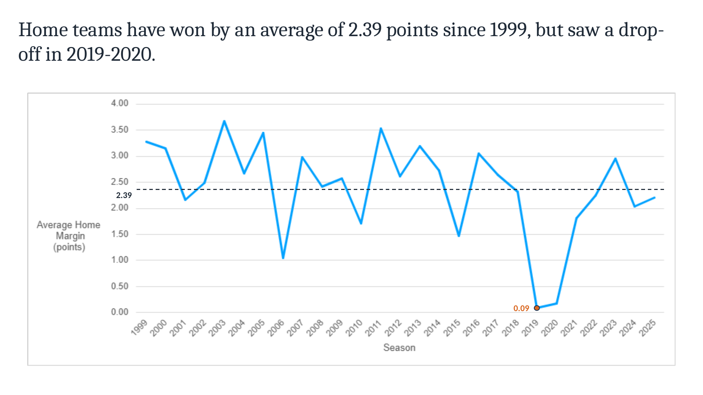

For this project, our team analyzed game-level NFL data covering 7,283 regular-season and playoff games from the 1999 season through the start of the 2026 season. The data came from \[source name\](https://\[link\]). Each row represents one game and includes the season, date, home and away teams, final score, home margin of victory, the pre-game point spread, the over/under line, roof type, kickoff temperature, wind speed, and stadium. Weather is only recorded for games played outdoors or with an open roof, so our temperature and wind analyses use the roughly 5,200 games with recorded weather. We kept all of the raw data on one master sheet and built a separate sheet for each question so every result traces back to the original data through formulas.

\

Has home field advantage changed over time? We chose this question because home field advantage is one of the most talked-about edges in football, and we wanted to know whether it still matters as much as it used to, especially after the 2020 season was played mostly in empty stadiums. For each season from 1999 to 2025, we used COUNTIFS to count the games played and AVERAGEIFS to find the average home margin of victory (home score minus away score). Across 7,182 games, home teams won by an average of 2.39 points, but the advantage nearly disappeared in 2019 (0.09 points) and 2020 (0.17 points) before partly recovering to between 1.81 and 2.95 points from 2021 to 2025. We used a time series line chart because it clearly shows change from season to season. We started the y-axis at zero so the size of the 2019–2020 drop is easy to see, added axis titles, and wrote an assertion above the chart that summarizes our conclusion.

\

Which teams are most favored when playing at home? Some stadiums are known as tough places to play, and we wanted to see which teams oddsmakers actually expect to win at home. For each of the 32 teams, we used COUNTIFS to count home games and AVERAGEIFS to find the team's average point spread at home, where a positive number means the home team was favored. After sorting the results, the New England Patriots were the most favored at home by 5.91 points on average, followed by the Green Bay Packers (5.22) and Baltimore Ravens (4.72), while the Browns, Raiders, Cardinals, and Jets were underdogs at home on average. To build the visual, we used a bar chart sorted from lowest to highest so all 32 teams could be compared at once, highlighted the teams named in our assertion in contrasting colors, and added axis titles that explain what the point spread means.

\

How cold or hot are NFL games? NFL games are played from September to February in cities from Miami to Green Bay, and cold-weather games get a lot of attention, so we wanted to know what conditions a typical game is actually played in. We created 10°F temperature bins from −10°F to 110°F and used COUNTIFS to count how many games fell into each bin, then divided by the total to find the percentage of games in each range. The average kickoff temperature was 58°F, and about 73% of games were played between 40°F and 80°F, while only about 5% were colder than 30°F. We chose a histogram because it shows the shape of the entire temperature distribution rather than just one average. We removed the gaps between bars to show that temperature is continuous and labeled each temperature range on the x-axis.

\

Do oddsmakers expect fewer points when it is windy? Wind makes passing and kicking harder, so we expected windy games to be lower scoring, and the over/under line shows exactly how many total points oddsmakers expect. We built a sheet pairing each game's wind speed with its over/under line and plotted all 5,192 games on a scatter plot. To make the pattern clearer, we grouped games into wind ranges and used COUNTIFS and AVERAGEIFS to find the average over/under in each range. The average line dropped steadily from 43.1 points in calm games (0–5 mph) to 40.8 points when winds were above 20 mph, which shows that oddsmakers do lower their expectations in windy games, but only by about 2 points. We used a scatter plot because both variables are numeric, labeled both axes with units, and set the axis ranges to fit the data so the relationship is easy to read.

\
