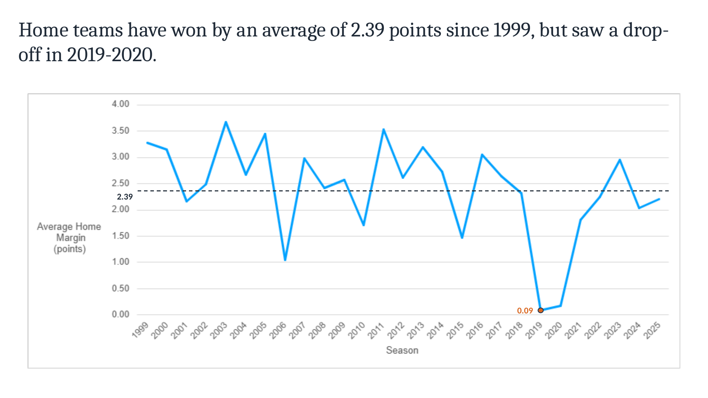
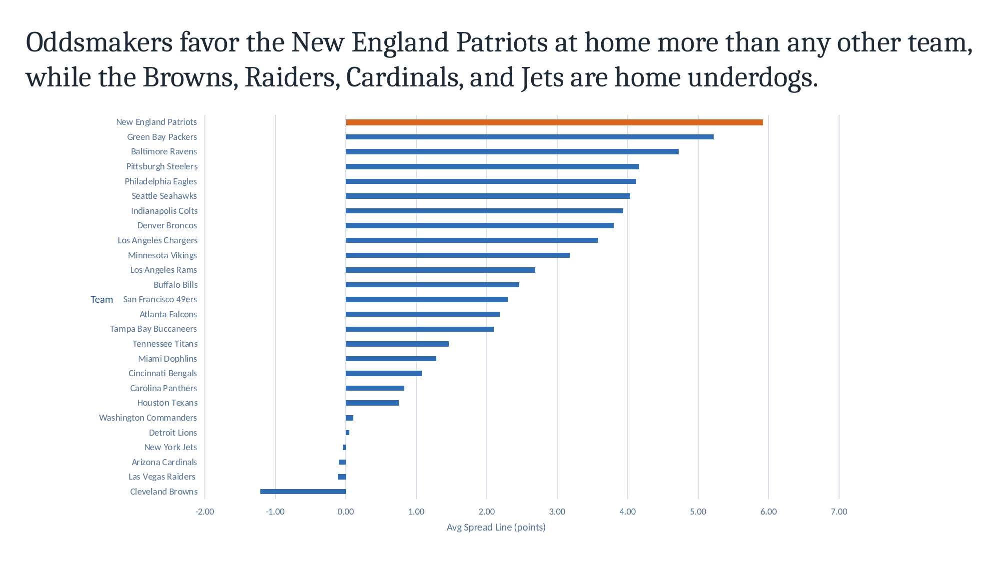
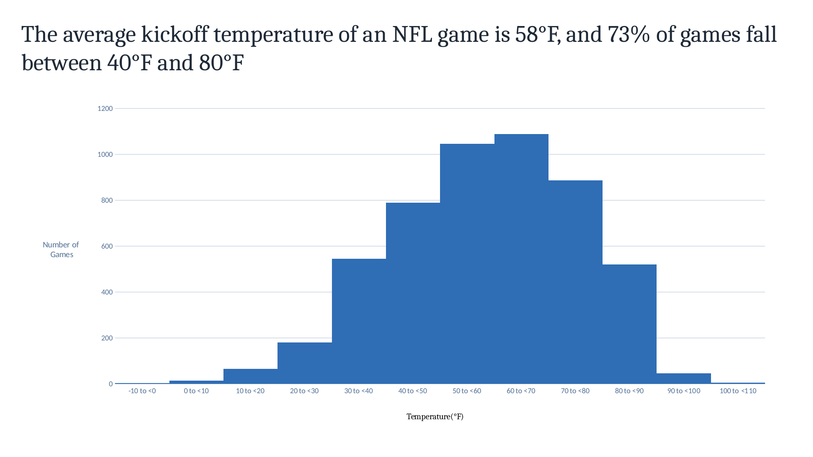
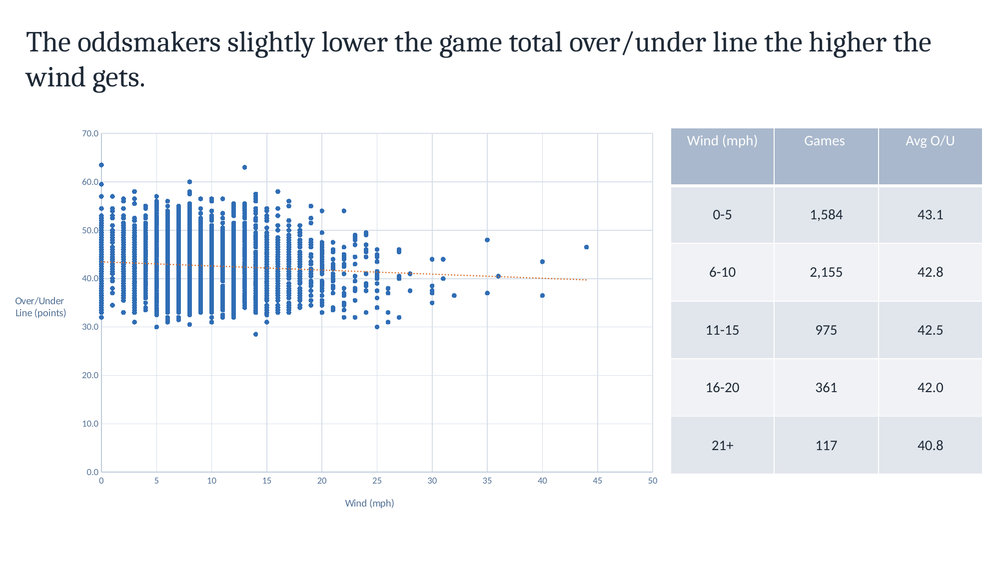

Has home field advantage changed over time? We chose this question because this is one of the most known edges in sports, but does it still matter as much as it used to. We saw a significant drop off in average home win margin at the end of the 2019 season into the 2020 season due to the stadiums being empty from COVID.
For each season from 1999 to 2025, we used COUNTIFS to count the games played and AVERAGEIFS to find the average home margin of victory. We used a time series line chart because it clearly shows change from season to season. We added a dashed line marking the 2.39-point average and labeled the 2019 low point.

Which teams are most favored when playing at home? A lot of stadiums are notorious for being hard to play. We wanted to see which teams oddsmakers actually expect to win at home. For each team, we used COUNTIFS to count home games and AVERAGEIFS to find the team's average point spread at home. The New England Patriots were the most favored at home and the Browns, Raiders, Cardinals, and Jets were underdogs at home on average. We used a horizontal bar chart to visualize this. It is sorted from highest to lowest, highlighted the top.

How cold or hot are NFL games? The NFL season starts in August and ends in February. They play in cities from Minneapolis to Dallas and New York to L.A. So we wanted to know what conditions a typical game is actually played in. We created 10°F temperature bins from −10°F to 110°F and used COUNTIFS to count how many games were in each bin. We chose a histogram because it shows the shape of the entire temperature distribution rather than just one average.

Do oddsmakers expect fewer points when it is windy? Wind affects a lot of different outcomes in a football game. Passing and kicking accuracy becomes much harder so you'd expect the windy days to be lower scoring.  The game total over/under lines tell you exactly how much the oddsmakers think the teams are going to score. The line has a slight trend downward but not to much. This may be because of the shift most teams are making to an indoor stadium. To make the pattern clearer, we grouped games into wind ranges and used COUNTIFS and AVERAGEIFS to find the average over/under in each range. We added a linear trendline to show the overall direction, and placed a table of average over/under lines by wind range beside the chart so the small drop is easy to see. 

